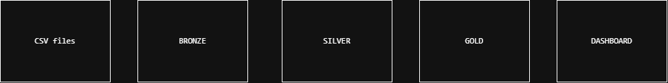
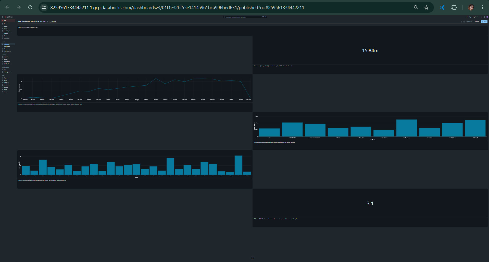

# E-Commerce Sales Lakehouse on Databricks

**Problem:** Olist's raw order data is split across 9 messy CSV files.
**Solution:** A medallion pipeline (bronze → silver → gold) on Databricks that produces clean Delta tables and a 5-KPI dashboard.

## Tech stack
Python · PySpark · Spark SQL · Delta Lake · Databricks

## Results
- Processed 9 files / ~100K orders / 1,550,922 rows in total
- 3 data-quality checks; 0 bad rows quarantined
- Incremental MERGE load: full rebuild 2.5 s, one-month MERGE 3.4 s (small dataset); rerun added 0 duplicates
- Finding: State AL has the highest late-delivery rate at 20.8%

## How to run
1. Download the dataset from Kaggle (https://www.kaggle.com/datasets/olistbr/brazilian-ecommerce)
2. Upload the CSVs to a Databricks volume
3. Run notebooks 01 → 05, or run the Databricks Job

